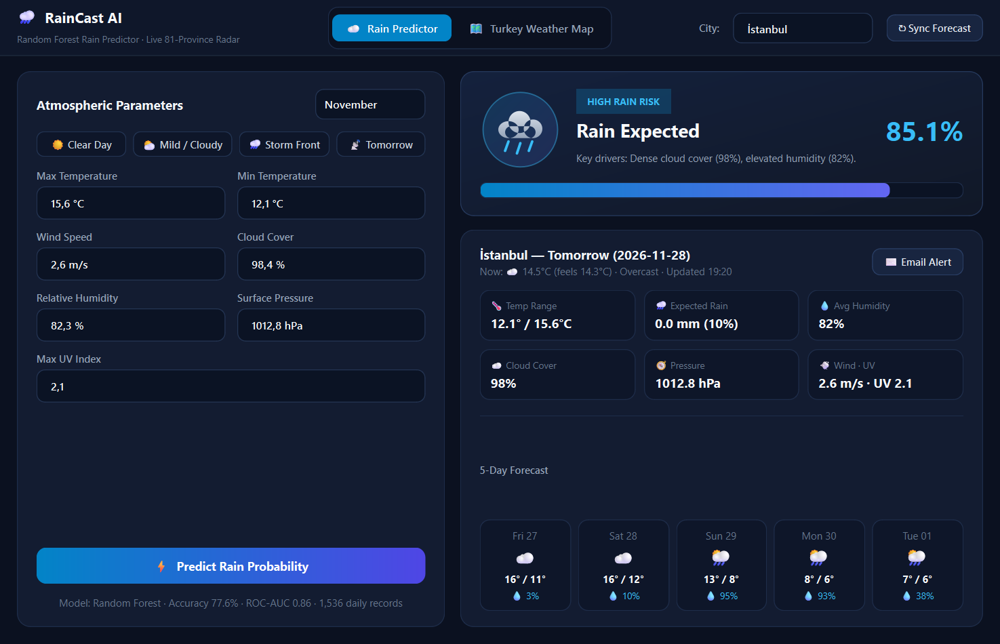
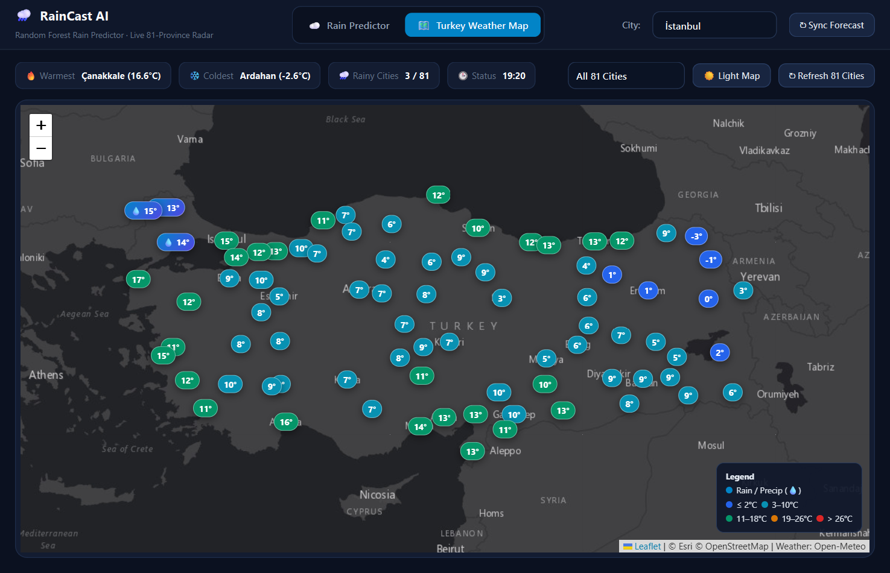

# 🌧️ RainCast AI — Rain Prediction & Live Turkey Weather Radar

A modern **PyQt6 desktop application** that predicts rain probability using a **Random Forest** machine learning model trained on historical daily meteorological observations, combined with live forecasts and an interactive **81-province Turkey weather radar map**.



## ✨ Features

- **ML Rain Probability Predictor**: Uses a calibrated 5-model soft-voting **Ensemble** (`HistGradientBoosting + GradientBoosting + RandomForest + ExtraTrees + MLP`) trained on **15,344 daily observations across Turkey's 7 climate regions** (`2020–2025`, `data/turkey_weather_dataset.csv`) with 18 physics-informed features (dew point, dew spread, sea-level pressure anomaly, storm index, cyclical seasonality).
- **Exploratory Data Analysis (EDA)**: Includes a full reproducible data quality & statistical audit ([docs/EDA_REPORT.md](docs/EDA_REPORT.md)) and visual EDA dashboard (`src/eda.py`).
- **Real-Time Forecast Sync (Zero API Key Required)**: Powered by [Open-Meteo](https://open-meteo.com/), automatically fetches live weather and tomorrow's true daily averages (temperature, wind speed, cloud cover, humidity, surface pressure, UV index) for all **81 Turkish provinces**.
- **Interactive Turkey Weather Map**: Asynchronous, non-blocking Leaflet map displaying real-time temperature pills, rain indicators (`💧`), warmest/coldest city stats, Dark/Light map themes, and Rainy/Clear filtering across all 81 provinces.
- **Quick Scenario Presets**: One-click atmospheric presets (*Clear Day*, *Mild / Cloudy*, *Storm Front*, *Tomorrow*) to explore how weather parameters drive model predictions.
- **5-Day City Outlook & Optional Email Alerts**: Visual 5-day forecast strip and optional SMTP email alert dialog configured safely via `.env`.



## 🗂️ Project Structure

```text
RainPrediction/
├── app.py                        # Root entry point (`python app.py`)
├── requirements.txt              # Python dependencies
├── .env.example                  # Optional SMTP email configuration template
├── src/
│   ├── __init__.py
│   ├── features.py               # Physics-informed meteorological feature engineering (18 features)
│   ├── fetch_dataset.py          # Open-Meteo 6-year multi-region Turkey dataset downloader
│   ├── eda.py                    # Exploratory Data Analysis (EDA) & chart generator
│   ├── train_model.py            # 5-model ensemble training, temporal & 5-fold CV pipeline
│   ├── weather_api.py            # 81 Turkish provinces catalog & live Open-Meteo client
│   └── ui.py                     # Main PyQt6 desktop application & Turkey map UI
├── tests/
│   ├── test_features.py          # Feature engineering math & edge-case tests
│   ├── test_eda.py               # Dataset quality & EDA integrity tests
│   ├── test_model.py             # Model quality gates & meteorological sanity tests
│   ├── test_weather_api.py       # 81-province catalog & mocked API client tests
│   └── test_ui.py                # PyQt6 widget & interaction functional tests
├── data/
│   └── turkey_weather_dataset.csv # 15,344 daily records across 7 Turkish climate regions (2020–2025)
├── models/
│   └── rain_model.pkl            # Trained 5-model Ensemble bundle
└── docs/
    ├── dashboard.png             # Desktop dashboard screenshot
    ├── turkey_map.png            # Live 81-province Turkey map screenshot
    ├── eda_overview.png          # 4-panel visual EDA overview
    ├── EDA_REPORT.md             # Full data quality, outlier & correlation audit
    └── RainCast_AI_Teknik_Rapor.pdf  # Full Turkish technical & ML report (PDF)
```

## 🚀 Quick Start

### 1. Clone and create a virtual environment

```bash
git clone https://github.com/Semihsrc24/RainPrediction.git
cd RainPrediction
python -m venv .venv
```

Activate the virtual environment:

- **Windows (PowerShell):**
  ```powershell
  .\.venv\Scripts\Activate.ps1
  ```
- **macOS / Linux:**
  ```bash
  source .venv/bin/activate
  ```

### 2. Install dependencies

```bash
pip install -r requirements.txt
```

### 3. Run the application

```bash
python app.py
```

## ✅ Running Tests

Run the full automated unit & PyQt6 functional test suite:

```bash
python -m unittest discover -s tests -v
```

## 📊 Exploratory Data Analysis (EDA)

Full data quality checks (missing values, duplicates, domain anomalies, IQR outliers, regional climate breakdown, and feature correlations) are documented in [docs/EDA_REPORT.md](docs/EDA_REPORT.md).


To regenerate the EDA report & visual dashboard:

```bash
python -m src.eda
```

## 🧠 Retraining the Model

To refresh the 6-year multi-region dataset from Open-Meteo Archive and retrain the 5-model Ensemble:

```bash
python -m src.fetch_dataset
python -m src.train_model
```

To optionally log experiment parameters and metrics to MLflow (if `mlflow` is installed):

```bash
python -m src.train_model --mlflow
```

### Model Performance (`15,344` days · 7 Climate Regions of Turkey)

| Evaluation Split | Accuracy | ROC-AUC | Rain Precision | Rain Recall | Rain F1 | Brier Score |
| :--- | :---: | :---: | :---: | :---: | :---: | :---: |
| **5-Fold Stratified CV (All 15,344 days)** | **85.83%** | **0.9322** | 82% | 75% | **0.7802** | **0.0987** |
| **Unseen Future Year Holdout (2025, 2,555 days)** | **86.58%** | **0.9386** | — | — | — | — |

### Model Features

| Feature | Unit | Source |
| :--- | :--- | :--- |
| `Max_Temperature` | °C | Daily maximum 2m temperature |
| `Min_Temperature` | °C | Daily minimum 2m temperature |
| `WindSpeed` | m/s | Daily mean 10m wind speed |
| `CloudCover` | % | Daily mean cloud cover |
| `Humidity` | % | Daily mean relative humidity |
| `Pressure` | hPa | Daily mean surface pressure |
| `Uvi` | index | Daily max UV index |
| `Temp_Diff` | °C | Derived (`Max_Temperature - Min_Temperature`) |
| `Month` | 1–12 | Derived seasonal month |

## ✉️ Optional Email Alerts Setup

Weather forecasting and the 81-city Turkey map work **out of the box with no API keys**.  
If you want to send forecast summaries via email:

1. Copy `.env.example` to `.env`:
   ```bash
   cp .env.example .env
   ```
2. Fill in `SMTP_USER`, `SMTP_PASSWORD` (e.g., a Gmail App Password), and `ALERT_RECIPIENT_EMAIL`.
3. Never commit your `.env` file (it is ignored in `.gitignore`).

## 🛠️ Tech Stack

- **GUI**: PyQt6, PyQt6-WebEngine, Leaflet.js (Esri Dark Gray & World Street Map tiles)
- **Machine Learning**: scikit-learn (`RandomForestClassifier`, `GridSearchCV`), pandas, numpy, joblib
- **Weather Data**: Open-Meteo Forecast API
