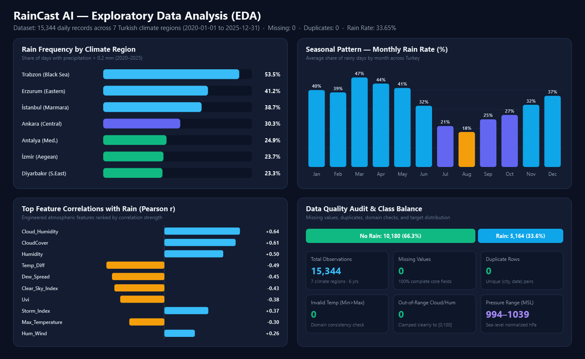

# 🌧️ Rain Prediction — Machine Learning Atmospheric Forecast

A general-purpose **Machine Learning rain prediction project** in Python that predicts rain probability directly from meteorological parameters using a calibrated **5-Model Soft-Voting Ensemble** (`HistGradientBoosting + GradientBoosting + RandomForest + ExtraTrees + MLP`) and physics-informed feature engineering, paired with an interactive PyQt6 interface and optional global live weather auto-fill.


## ✨ Highlights

- **General, Location-Independent Prediction**: Enter atmospheric readings (temperature, wind speed, cloud cover, humidity, sea-level pressure, UV index, month) for **any location worldwide** and immediately get a calibrated rain probability, risk tier, and real-time derived atmospheric indicators (dew point, dew spread, pressure anomaly, cloud×humidity, storm index).
- **High-Accuracy 5-Model Ensemble**: Achieves **85.83% 5-fold CV accuracy** (`0.9322` ROC-AUC, `0.0987` Brier score) and **86.58% accuracy / `0.9386` ROC-AUC** on an unseen future-year (`2025`) temporal holdout split across **15,344 daily multi-climate records**.
- **18 Physics-Informed Features**: Automatically computes Magnus-Tetens dew point, dew point depression, sea-level pressure anomaly, storm index, clear-sky index, and cyclical seasonality (`sin`/`cos`) from the 7 core inputs.
- **Optional Global Auto-Fill & Interactive Weather Map**: Optionally type *any city worldwide* (e.g., London, Tokyo, New York, Istanbul) to auto-fill tomorrow's live meteorological readings via [Open-Meteo](https://open-meteo.com/) (no API key required), or explore the interactive live weather map tab.
- **Full EDA & Automated Test Suite**: Includes a complete data quality & Exploratory Data Analysis report ([docs/EDA_REPORT.md](docs/EDA_REPORT.md)), a detailed Turkish technical report ([docs/RainCast_AI_Teknik_Rapor.pdf](docs/RainCast_AI_Teknik_Rapor.pdf)), and **23 automated tests**.

## 🗂️ Project Structure

```text
Rain_Prediction/
├── app.py                           # Main entry point (`python app.py`)
├── requirements.txt                 # Python dependencies
├── .env.example                     # Optional SMTP email configuration template
├── src/
│   ├── __init__.py
│   ├── features.py                  # Physics-informed meteorological feature engineering (18 features)
│   ├── fetch_dataset.py             # Open-Meteo 6-year multi-climate historical dataset builder
│   ├── eda.py                       # Exploratory Data Analysis (EDA) & chart generator
│   ├── train_model.py               # 5-model ensemble training, temporal & 5-fold CV pipeline
│   ├── weather_api.py               # Global Open-Meteo geocoding, forecast & live map client
│   └── ui.py                        # Interactive PyQt6 prediction interface & optional map tab
├── tests/
│   ├── test_features.py             # Feature engineering math & edge-case tests
│   ├── test_eda.py                  # Dataset quality & EDA integrity tests
│   ├── test_model.py                # Model quality gates & meteorological sanity tests
│   ├── test_weather_api.py          # Geocoding, WMO decoding & mocked API tests
│   └── test_ui.py                   # PyQt6 interface & functional tests
├── data/
│   └── turkey_weather_dataset.csv   # 15,344 daily multi-climate records (2020–2025)
├── models/
│   └── rain_model.pkl               # Trained 5-model Ensemble bundle
└── docs/
    ├── dashboard.png                # Main prediction interface screenshot
    ├── turkey_map.png               # Optional live weather map screenshot
    ├── eda_overview.png             # 4-panel visual EDA overview
    ├── EDA_REPORT.md                # Full data quality, outlier & correlation audit
    └── RainCast_AI_Teknik_Rapor.pdf # Technical & ML documentation report (TR)
```

## 🚀 Quick Start

### 1. Clone and create a virtual environment

```bash
git clone https://github.com/Semihsrc24/Rain_Prediction.git
cd Rain_Prediction
python -m venv .venv
```

Activate the virtual environment:

- **Windows (PowerShell):**
  ```powershell
  .\.venv\Scripts\Activate.ps1
  ```
- **macOS / Linux:**
  ```bash
  source .venv/bin/activate
  ```

### 2. Install dependencies

```bash
pip install -r requirements.txt
```

### 3. Run the application

```bash
python app.py
```

## ✅ Running Tests

```bash
python -m unittest discover -s tests -v
```

## 📊 Exploratory Data Analysis (EDA)

Full data quality checks (missing values, duplicates, domain anomalies, IQR outliers, climate comparisons, and feature correlations) are documented in [docs/EDA_REPORT.md](docs/EDA_REPORT.md).



To regenerate the EDA report & visual dashboard:

```bash
python -m src.eda
```

## 🧠 Model Performance & Retraining

### Evaluation Results (`15,344` multi-climate daily records)

| Evaluation Split | Accuracy | ROC-AUC | Rain Precision | Rain Recall | Rain F1 | Brier Score |
| :--- | :---: | :---: | :---: | :---: | :---: | :---: |
| **5-Fold Stratified CV (All 15,344 days)** | **85.83%** | **0.9322** | 82% | 75% | **0.7802** | **0.0987** |
| **Unseen Future Year Holdout (2025, 2,555 days)** | **86.58%** | **0.9386** | — | — | — | — |

To refresh the dataset and retrain the model:

```bash
python -m src.fetch_dataset
python -m src.train_model
```

### Core & Engineered Features

| Feature | Unit | Description |
| :--- | :--- | :--- |
| `Max_Temperature`, `Min_Temperature` | °C | Daily temperature bounds |
| `Temp_Mean`, `Temp_Diff` | °C | Daily mean & diurnal temperature swing |
| `WindSpeed` | m/s | Mean wind speed |
| `CloudCover`, `Humidity` | % | Daily cloud cover & relative humidity |
| `Pressure`, `Pressure_Dev` | hPa | Sea-level pressure & anomaly from 1013.25 hPa |
| `Uvi`, `Clear_Sky_Index` | index | Max UV index & cloud-normalized solar index |
| `Dew_Point`, `Dew_Spread` | °C | Magnus-Tetens dew point & saturation gap |
| `Cloud_Humidity`, `Storm_Index`, `Hum_Wind` | derived | Atmospheric moisture & cyclonic interaction terms |
| `Month_Sin`, `Month_Cos` | -1 to 1 | Cyclical seasonal encoding |

## ✉️ Optional Email Summary Setup

Direct prediction and optional global live forecast auto-fill work **out of the box with no API keys**.  
If you want to send prediction summaries via email:

1. Copy `.env.example` to `.env`
2. Fill in `SMTP_USER`, `SMTP_PASSWORD`, and `ALERT_RECIPIENT_EMAIL`
3. Never commit your `.env` file (ignored in `.gitignore`).

## 🛠️ Tech Stack

- **Machine Learning & Data**: `scikit-learn`, `pandas`, `numpy`, `joblib`
- **Interface & Mapping**: `PyQt6`, `PyQt6-WebEngine`, `Leaflet.js`
- **Weather Data**: Open-Meteo Forecast, Geocoding & Historical Archive APIs
- **Testing**: `unittest`, `unittest.mock`
